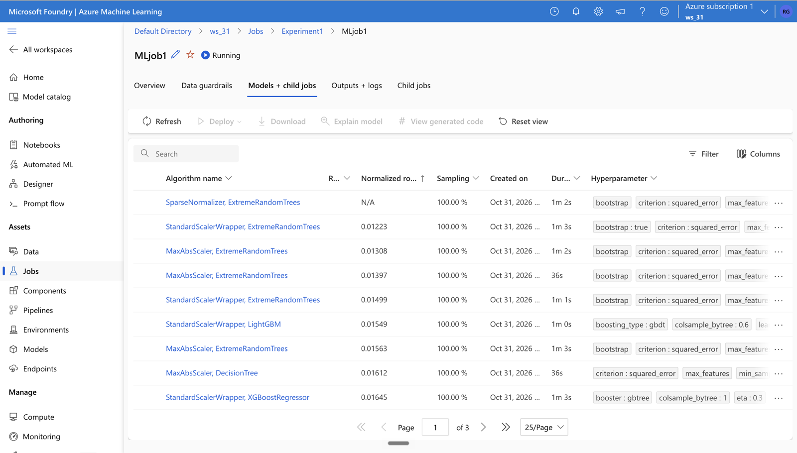
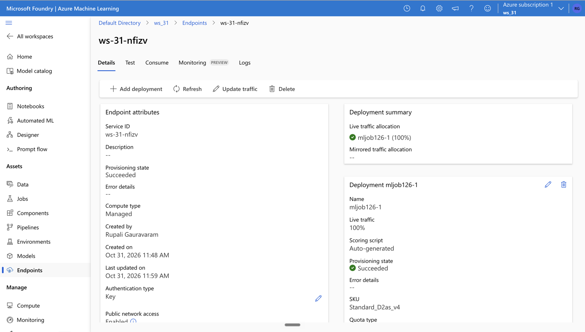
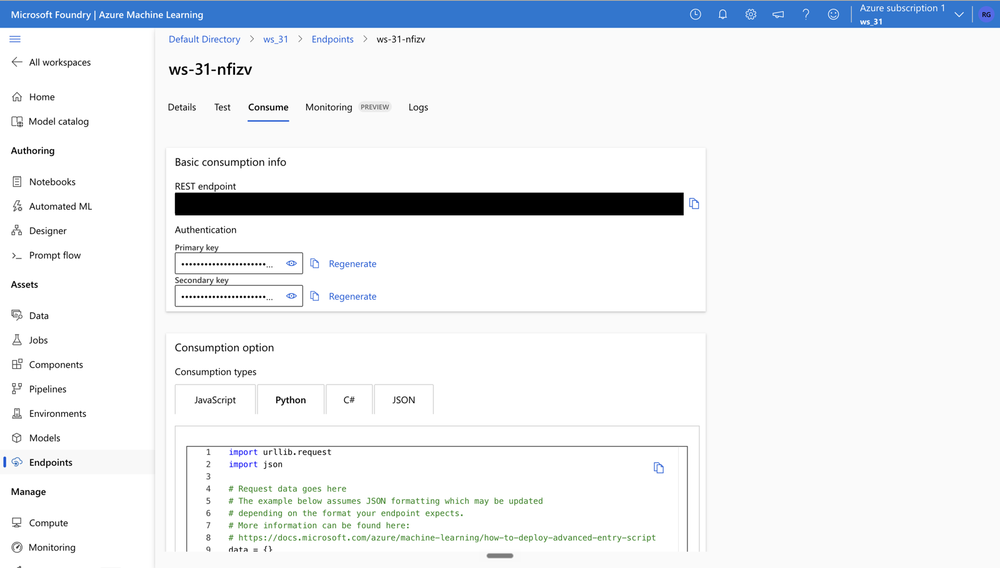

# Insurance Charges Prediction: AutoML model deployed as a real-time endpoint on Azure ML
*Built 31 Oct 2026 during an MLOps course (IIT Roorkee · Intellipaat). The Azure resources were deleted afterwards to avoid cost; this repository is the record.*

## What it does
Predicts a customer's **medical insurance charges** (regression) from 12 inputs: age, sex, BMI, children, smoker, claim amount, past consultations, number of steps, hospital expenditure, number of past hospitalisations, annual salary and region. The model is served as a **REST API** and called from Python.

## Pipeline

```
Resource group → Azure ML workspace (+ storage, key vault, App Insights, Log Analytics)
   → Data asset (CSV → MLTable)
   → Automated ML job (featurisation + scaler/algorithm search, ranked by the primary metric)
   → Registered model (MLflow format)
   → Managed online endpoint (key auth, auto-generated scoring script, 1 × Standard D2 v4 instance)
   → REST call from Python (JSON in, prediction out)
```

## Steps (all in Azure Machine Learning)
1. **Resource group** `rs_31` + **Azure ML workspace** `ws_31` (Australia East). Azure created the supporting storage account, key vault, Application Insights and Log Analytics.
2. **Data asset** `insurance` (v1): `new_insurance_data.csv`, **1,338 rows × 13 columns** (12 features + target `charges`); some values are null.
3. **Automated ML regression job** (`MLjob1`, Experiment1): AutoML tried many scaler + algorithm combinations (ExtremeRandomTrees, LightGBM, XGBoostRegressor, DecisionTree…), ranked by **normalised RMSE**. The best model so far was **StandardScalerWrapper + ExtremeRandomTrees (normalised RMSE ≈ 0.012)**. The job was still searching (3 pages of child models, ~3 hours in) when it was stopped; a child model was deployed mid-run, which AutoML allows. Featurization: Auto.
4. **Registered model** `mljob126` (v1), MLflow format (scikit-learn 1.5.1, curated AutoML environment).
5. **Managed online endpoint** `ws-31-nfizv` → deployment `mljob126-1`, **100% of traffic**, instance `Standard_D2as_v4` × 1, auto-generated scoring script, **key authentication**. Provisioning: **Succeeded**.
6. **Consumed over REST** from Python (`consume_endpoint.py`): JSON in (`input_data` with columns + rows), prediction out.

## Result
Sample request: age 27, male, BMI 27, 2 children, smoker, claim 16,000, 5 past consultations, 8,000 steps, hospital expenditure 45,000, 1 past hospitalisation, annual salary 140,000, northwest → **predicted charges ≈ 12,104**.

## Files here
- `screenshots/` (12): resource group, workspace, data asset (details + preview), jobs, AutoML child models, endpoint list, endpoint details, the consume tab.
- `model_artifacts.zip`: the deployed model (`model.pkl`, `MLmodel`, `conda.yaml`, `python_env.yaml`, `requirements.txt`).
- `deployment_consume.ipynb`: the notebook that called the live endpoint (URL and key replaced by environment variables; outputs kept).
- `consume_endpoint.py`: the client code, **with no key in it** (it reads the key from an environment variable).

## Screenshots







## Author
**Rupali Gauravaram**: MSc Climate Resilience & Environmental Sustainability (University of Liverpool), Advanced Certification in Data Science & AI (IIT Roorkee).
[LinkedIn](https://linkedin.com/in/rupali99) · [GitHub](https://github.com/Rupali-Gauravaram)
